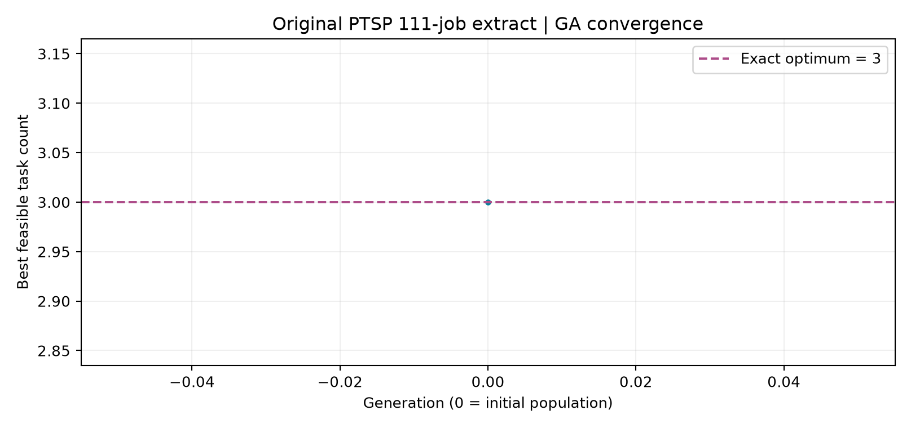

# Algorithms Project — Task Scheduling (GA + Greedy Repair)

[**🌐 Live Web App — Launch Task Scheduling**](https://alg-task-scheduling-ga.streamlit.app/)  
[**💻 GitHub Repository — Source Code**](https://github.com/khaledAlzeer/task-scheduling-ga-greedy)

**Deployment:** Streamlit Community Cloud · branch `main` · entry point `app.py`

**Team:** Khaled Alzeer (202310298), Heba Alshawish (202310102), Mohammad Jaber (202312665)  
**Course:** Algorithms — Dr. Katrina  
**Phase 3:** Python Implementation and Initial Testing

## Problem

Given tasks with fixed start and finish times, select the maximum number of non-overlapping tasks on a **single resource**. Intervals are treated as `[start, finish)`, so back-to-back tasks are allowed. All tasks have equal priority. The solution is a binary (0/1) decision vector; the objective is to maximize the number selected subject to no overlaps.

The main evolutionary method is a **binary Genetic Algorithm (GA)** with tournament selection, one-point crossover, bit-flip mutation, elitism, and deterministic **Greedy feasibility repair**. Classical earliest-finish Greedy is also computed as an **exact reference** for this standard unweighted problem. The GA is **not** claimed to outperform exact Greedy. The known optimum may be used as an early-stopping target, but the exact solution is **not inserted** into the GA population.

## Live application

**Open the deployed website:** https://alg-task-scheduling-ga.streamlit.app/

The web app provides:

- CSV, TSV, TXT, Excel (`.xlsx`), and original PTSP (`.dat`) dataset input.
- Editable manual task entry and an included 111-task example.
- Flexible column assignment, with validation of missing or invalid values and time intervals.
- Configurable GA settings and an exact Greedy reference.
- Selected-job count, optimality gap, generations, evaluations, execution time, and stop reason.
- Convergence plots, selected-task schedule visualization, and selected-jobs CSV download.

The publicly deployed app was tested from a private/incognito browser window with the included **111-task** example. It returned **GA = 3**, **exact Greedy optimum = 3**, and **gap = 0**. This is a deployment smoke test, not a guarantee of future availability or speed.

## Files

| File | Purpose |
|---|---|
| `alg.py` | Optimization code without UI dependencies: validation, exact Greedy, feasibility repair, GA, metrics and history |
| `data_io.py` | File readers, flexible column mapping, error messages, and PTSP `.dat` parsing |
| `app.py` | Streamlit interface for file uploads, manual entry and the included original dataset |
| `test_alg.py` | 12 automated unit tests for representation, fitness, repair, reproducibility and invalid formats |
| `run_experiments.py` | Generates nine documented derived scenarios; tests three sizes plus the original and saves figures/results |
| `data/` | Original PTSP-derived CSV, original `.dat`, nine labeled derived scenarios, manual example and dataset manifest |
| `figures/` | Convergence charts, selected-job interval plots and implementation evidence images |
| `results/` | Measured results and environment/repeatability diagnostics |
| `requirements.txt` | Python dependencies |
| `.gitignore` | Excludes virtual environments, caches, secrets and temporary files |

## Setup

Python 3.10+ is recommended, using VS Code or another Python IDE. **Locally verified on Windows / VS Code Git Bash using Python 3.13.6, pandas 2.3.3 and Matplotlib 3.11.2 (2026-11-11).** Create a project-specific environment:

```sh
python -m venv .venv
# Windows Git Bash: source .venv/Scripts/activate
# Windows PowerShell: .venv\Scripts\Activate.ps1
# macOS/Linux: source .venv/bin/activate
python -m pip install -r requirements.txt
```

### Start the interface locally

```sh
python -m streamlit run app.py
```

1. Choose **Load a dataset file**, **Enter tasks manually**, or **Use included 111-task example**.
2. Upload `.csv`, `.tsv`, `.txt`, `.xlsx`, or original PTSP `.dat`. Common synonyms (`start`, `begin`, `end`, `finish`, `job`) are recognized; headerless numeric pairs are supported.
3. If labels are unusual, map columns using the dropdowns. Unknown labels are **not guessed**. Missing, invalid, duplicate or contradictory values are rejected with an error.
4. Change GA settings if desired or keep the default values. Press **Find an optimal-compatible schedule**.
5. Inspect the selected/unselected tasks, objective count, exact reference, gap, generation count, time and charts. Download selected jobs as CSV.

### Data format

Preferred CSV:

```csv
task_id,start_time,finish_time
A,1,3
B,2,5
C,3,4
```

Alternatives include `job,begin,end` column names; headerless, two-column start/finish pairs (with generated task IDs); and the original PTSP `Jobs = N` `.dat` file, with unrelated qualifications excluded. Excel reads the first sheet. Values are in the source's numeric time units: clock strings like `09:30` are **not** automatically parsed as numerical times. Every task must satisfy `finish_time > start_time`.

## Run Phase 3 tests and reproducible experiments

```sh
python -m unittest -v test_alg
python run_experiments.py
```

The experiment script recreates **nine derived datasets**: sizes `25`, `60`, and `111` crossed with profiles `best`, `average`, and `worst`, and also runs the unchanged original 111-task extract. Here, **best/average/worst describe overlap density, not theoretical best/average/worst running-time complexity**. Derived datasets preserve original task IDs and durations but change schedule positions; they are **synthetic transformations, not published PTSP benchmark observations**.

See `data/DATASET_MANIFEST.json` for source provenance, original file, transformation methods, fixed seed, SHA-256 fingerprints, column definitions and reference optima.

On the original 111-task PTSP extract, earliest-finish Greedy selects `T007`, `T036`, and `T081`, giving an exact optimum of **3**. The six-task manual example has an exact optimum of **4** (`A`, `C`, `E`, `F`). Runtime varies by computer even with the same random seed.

## Phase 3: actual local test results (2026-11-11)

On Windows / Git Bash, **12 unit tests passed** and the experiment runner reported **`Repeatability (seed 42): True`**. All 10 resulting schedules were feasible. The table records actual measurements, **not** theoretical performance guarantees.

| Input profile | Tasks | GA selected | Exact Greedy optimum | Gap | Generations | Feasible |
|---|---:|---:|---:|---:|---:|---|
| 25-best | 25 | 25 | 25 | 0 | 14 | Yes |
| 25-average | 25 | 11 | 11 | 0 | 8 | Yes |
| 25-worst | 25 | 1 | 1 | 0 | 0 | Yes |
| 60-best | 60 | 58 | 60 | 2 | 100 | Yes |
| 60-average | 60 | 26 | 28 | 2 | 100 | Yes |
| 60-worst | 60 | 1 | 1 | 0 | 0 | Yes |
| 111-best | 111 | 100 | 111 | 11 | 100 | Yes |
| 111-average | 111 | 48 | 52 | 4 | 100 | Yes |
| 111-worst | 111 | 1 | 1 | 0 | 0 | Yes |
| 111-original-PTSP | 111 | 3 | 3 | 0 | 0 | Yes |

Additional interactive UI tests completed: original CSV and PTSP `.dat` uploads; Excel `.xlsx`; headerless CSV; alternative column names; manual task entry; rejection of missing numeric times and reversed intervals. Those were **interactive checks**, distinct from the 12 automated tests.

Saved measurements: [`results/phase3_results.csv`](results/phase3_results.csv). Dataset details: [`data/DATASET_MANIFEST.json`](data/DATASET_MANIFEST.json).

### Figures

The following plots are generated by `run_experiments.py` and reflect the recorded runs:

- [`figures/convergence_25.png`](figures/convergence_25.png)
- [`figures/convergence_60.png`](figures/convergence_60.png)
- [`figures/convergence_111.png`](figures/convergence_111.png)
- [`figures/convergence_original.png`](figures/convergence_original.png)



The `figures/evidence_*.png` files are supporting documentation images. For academic submission, verify that screenshots match the final code and include actual IDE/execution screenshots as required.

## GA implementation details

`run_genetic_algorithm()` uses population size `30`, up to `100` generations, crossover probability `0.8`, per-bit mutation probability `0.05`, initial-one probability `0.5`, tournament size `3`, elite count `1`, and seed `42`. Each candidate is made feasible by finish-time Greedy repair. The program records best-so-far fitness and stops when the exact reference optimum is reached or the generation limit is reached.

Its `GAResult` contains selected/rejected IDs, fitness, exact optimum, gap, generation count, evaluations, elapsed time, convergence history, stop reason and seed.

**Complexity:** sorting once is `O(n log n)`; each repaired candidate scans `n` tasks in `O(n)`. For population `P` and `G` generations, time is `O(n log n + G·P·n)`, and memory is `O(P·n + n)` plus output history `O(G)`. Classical exact Greedy is retained as a benchmark because this particular unweighted task-selection problem has an efficient optimal algorithm.

## Limitations and academic integrity

- This is not full personnel scheduling, weighted scheduling, dependency scheduling, multi-machine assignment or a job-shop solver.
- Input times must be numeric; ambiguous columns require explicit mapping; malformed rows are not silently discarded.
- The derived profiles are synthetic transformations of a research benchmark. Source: Mathprog-ORlib PTSP, archive `ptask.zip`, file `Data_10_51_111_66.dat`: https://andreas-ernst.github.io/Mathprog-ORlib/info/readmePTSP.html
- Experimental GA parameter tuning and statistical comparisons are reserved for **Phase 4**.
- Team-contribution statements in any submitted PDF should reflect each member's actual work.

## GitHub and deployment

- **Live website:** https://alg-task-scheduling-ga.streamlit.app/
- **Source repository:** https://github.com/khaledAlzeer/task-scheduling-ga-greedy
- **Hosting:** Streamlit Community Cloud
- **Repository branch:** `main` (**not** `master`)
- **Entry point:** `app.py`
- **Dependencies:** `requirements.txt` at repository root

The **GitHub button in the app** opens the source repository; the **Live Web App link here** opens the deployed website.

### Updating the published app

After changing and testing files locally, commit and push to `main`:

```bash
python -m unittest -v test_alg
git status
git add .
git commit -m "Describe the changes"
git push origin main
```

Streamlit Community Cloud redeploys when changes are pushed to the connected branch. Do **not** commit `.venv/`, credentials or private data (see `.gitignore`).
